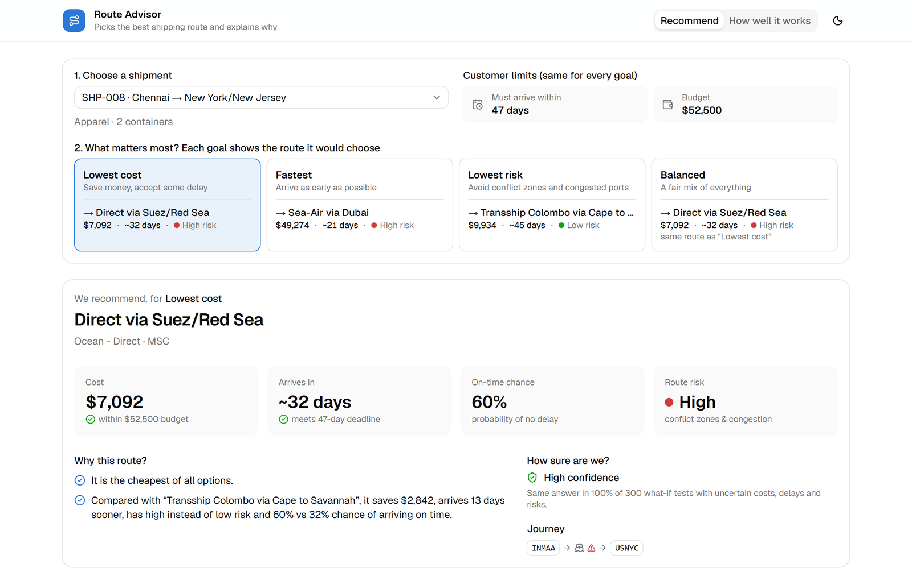
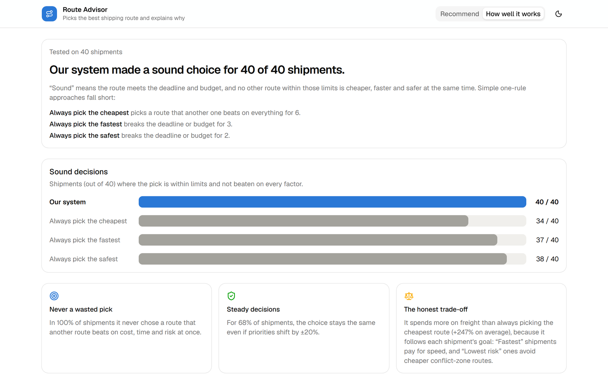

# Route Advisor

Recommends the best shipment route by balancing **cost, transit time, delay risk and geopolitical/congestion risk**, and explains the decision in plain English.



Each shipment has 3–5 route options made of legs (sea, rail, truck, air). The cheapest route often crosses a conflict zone, the fastest costs many times more, and the safest takes weeks longer. Route Advisor:

1. **evaluates** every route against the shipment's deadline, budget and cargo rules,
2. **recommends** the route closest to the ideal trade-off for the shipment's priority (lowest cost, fastest, lowest risk or balanced),
3. **explains** why it beats the alternatives, and says how stable that answer is.

A full walkthrough of every screen, the data flow, the weights and the algorithms is in **[Route_Advisor_Report.pdf](Route_Advisor_Report.pdf)**.

---

## Quick start

Requirements: **Python 3.12+** and **Node.js 20+**.

### 1. Backend (FastAPI)

```bash
cd backend
python -m venv venv

# Windows (PowerShell)
.\venv\Scripts\Activate.ps1
# Windows (cmd)
venv\Scripts\activate
# macOS / Linux
source venv/bin/activate

pip install -r requirements-dev.txt
uvicorn main:app --reload
```

The API runs at http://127.0.0.1:8000, with interactive docs at http://127.0.0.1:8000/docs.

### 2. Frontend (React)

In a second terminal:

```bash
cd frontend
npm install
npm run dev
```

Open http://localhost:5173. The dev server forwards `/api` calls to the backend, so both must be running.

Useful links: `http://localhost:5173/?shipment=SHP-008` opens a specific shipment; `http://localhost:5173/#evaluate` opens the evaluation tab.

### 3. Tests

```bash
cd backend
pytest -q        # 25 tests: feasibility, Pareto, TOPSIS, fallback, sensitivity, every endpoint
```

### 4. Deploy (Render)

[render.yaml](render.yaml) creates both services: in Render choose **New → Blueprint** and pick this repo. Then link them:

| Service | Variable | Value |
|---|---|---|
| `route-advisor` (web app) | `VITE_API_URL` | the API's URL, e.g. `https://route-advisor-api.onrender.com`; redeploy after setting it |
| `route-advisor-api` (API) | `CORS_ORIGINS` | the web app's URL, e.g. `https://route-advisor.onrender.com` |

On the free plan the API sleeps when idle, so the first request after a pause can take up to a minute.

---

## How a route is picked

```
 Hard constraints  →  Expected cost  →  Pareto filter  →  TOPSIS ranking  →  Explain + stress-test
 (deadline, budget,   (freight + late    (drop routes      (closest to the     (plain-English reason,
  hazmat by air)       penalty + loss)    beaten on all)    ideal route)        ±20% weights, Monte Carlo)
```

Four criteria are scored, all lower-is-better: **cost** (expected total cost), **time** (expected days including likely delay), **risk** (0.6 × geopolitical + 0.4 × congestion) and **delay** (probability of arriving late). The shipment's priority sets the weights:

| Priority | Cost | Time | Risk | Delay |
|---|---|---|---|---|
| Lowest cost | **0.60** | 0.15 | 0.10 | 0.15 |
| Fastest | 0.15 | **0.60** | 0.10 | 0.15 |
| Lowest risk | 0.15 | 0.15 | **0.60** | 0.10 |
| Balanced | 0.30 | 0.25 | 0.20 | 0.25 |

Operators can also set custom weights, or test a different deadline or budget, from the UI or the API.

### Algorithms and where they live

| Algorithm | What it does | Code |
|---|---|---|
| Hard-constraint filter | Rejects routes over budget, late, or hazardous cargo by air | [scoring.py](backend/services/engine/scoring.py) → `check_feasibility` |
| Expected-cost model | Freight + expected late penalty + expected cargo loss | [scoring.py](backend/services/engine/scoring.py) → `build_metrics` |
| Pareto dominance | Removes routes beaten on every criterion | [scoring.py](backend/services/engine/scoring.py) → `pareto_flags` |
| **TOPSIS** (min-max) | Ranks routes by closeness to the ideal | [scoring.py](backend/services/engine/scoring.py) → `topsis` |
| Least-violation fallback | When no route fits, picks the closest miss | [scoring.py](backend/services/engine/scoring.py) → `limit_violation` |
| Explanation rules | Winner vs runner-up: what it gains and gives up | [explain.py](backend/services/engine/explain.py) → `explain` |
| Weight sensitivity | Each weight ±20%: does the pick hold? | [uncertainty.py](backend/services/engine/uncertainty.py) → `weight_scenarios` |
| Monte Carlo | 300 noisy re-runs: win rate per route | [uncertainty.py](backend/services/engine/uncertainty.py) → `monte_carlo` |
| Baseline evaluation | System vs always cheapest / fastest / safest | [recommend_service.py](backend/services/recommend_service.py) → `evaluate` |

---

## Evaluation

There is no "correct" route in synthetic data, so the system is compared with the simple rules a planner might otherwise use. A decision is **sound** when the route meets the deadline and budget and no other route within those limits is as good or better on every criterion.

| Strategy (40 shipments) | Sound decisions |
|---|---|
| **Route Advisor** | **40 / 40** |
| Always pick the cheapest | 34 / 40 |
| Always pick the fastest | 37 / 40 |
| Always pick the safest | 38 / 40 |

68% of picks stay the same when any single weight moves by ±20%; the rest are flagged in the UI as close calls for a human to review. See the **How well it works** tab, or `GET /api/evaluate`.



---

## Data

The dataset is **synthetic**, as the assignment recommends: 40 shipments, 176 routes, 343 legs and 30 hubs on 8 real trade lanes (e.g. Shanghai → Rotterdam, Chennai → New York). Costs and delay rates are anchored to public 2026 industry figures; risk scores are hand-assigned estimates. How every field was built is described in **[data/DATA_README.md](data/DATA_README.md)**.

The backend reads only `data/dataset.json`. The CSV files are the same data as flat tables for review. To regenerate (about 1 minute, reproducible with seed 42):

```bash
cd data
../backend/venv/Scripts/python generate_synthetic_data.py      # Windows
../backend/venv/bin/python generate_synthetic_data.py          # macOS / Linux
```

---

## API

| Method | Path | Purpose |
|---|---|---|
| GET | `/health` | Liveness and number of shipments loaded |
| GET | `/api/shipments` | List shipments |
| GET | `/api/shipments/{id}` | One shipment with its routes and legs |
| GET | `/api/shipments/{id}/recommend` | Recommendation using the shipment's own priority |
| POST | `/api/recommend` | Recommendation with custom `priority`, `weights`, `max_transit_days` or `budget_usd` |
| GET | `/api/shipments/{id}/sensitivity` | ±20% weight scenarios and Monte Carlo stability check |
| GET | `/api/evaluate` | System vs simple-rule baselines on all shipments |
| GET | `/api/weights/presets` | Weights behind each priority |

Example:

```bash
curl -X POST http://127.0.0.1:8000/api/recommend \
  -H "Content-Type: application/json" \
  -d '{"shipment_id": "SHP-008", "priority": "time"}'
```

Configuration (environment variables) is listed in [backend/README.md](backend/README.md).

---

## Project structure

```
backend/
  main.py              app factory, middleware, start-up data check
  api/                 HTTP routers (thin)
  schemas/             Pydantic request/response models
  services/            use-cases: shipments, recommendation, sensitivity, evaluation
    engine/            pure decision logic, no web code: scoring.py, explain.py, uncertainty.py
  core/                config, logging, error handling
  tests/
frontend/
  src/components/      recommendation card, option cards, trade-off chart, route table, evaluation view
  src/lib/             typed API client, formatting, plain-English helpers
data/
  dataset.json         system input
  *.csv                same data as tables
  generate_synthetic_data.py
docs/                  screenshots
```

---

## Assumptions and limitations

- **Synthetic data.** Risk scores are relative estimates (0–1), not measurements. The dataset and generator were built with the help of an AI coding assistant. With real data (vessel tracking, port dwell times, carrier on-time history, war-risk listings) only the inputs would change, not the engine.
- **Hard cases on purpose.** Every shipment was generated so that its goals disagree, so results describe behaviour on real trade-offs rather than a random sample.
- **Independent delays.** One event delaying many routes at once (e.g. a canal closure) is not modelled; prices are a single snapshot.
- **Weights are policy, not learned.** They are reasoned defaults that could be fitted to planners' past decisions.
- **Selection, not routing.** The system ranks given route options; it does not search a network for new routes or book capacity.
